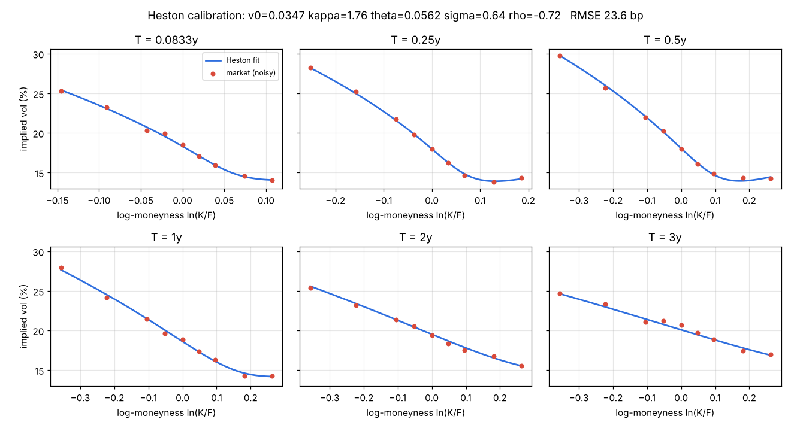
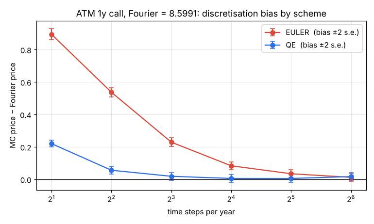

# quant-heston-calib

Heston (1993) stochastic-volatility model from scratch in NumPy: a numerically
stable characteristic function, two independent Fourier pricers, Andersen's QE
Monte Carlo scheme, and a Levenberg-Marquardt calibration to an implied-vol
surface that reports parameter standard errors and their correlations.

```
dS = (r - q) S dt + sqrt(v) S dW1
dv = kappa (theta - v) dt + sigma sqrt(v) dW2,     d<W1,W2> = rho dt
```



## What's inside

| file | what it does |
|---|---|
| `heston/pricing.py` | Characteristic function of ln(S_T/F) in the Albrecher et al. "little trap" form, with `b - d` computed as `-sigma^2(iu+u^2)/(b+d)` so the `sigma -> 0` limit doesn't dissolve into cancellation error. Lewis (2001) single-integral pricer (used for calibration) and the original Gil-Pelaez two-probability pricer (used as a cross-check), both on composite Gauss-Legendre panels that double in width out to u = 2048. |
| `heston/black.py` | Black-76 price and vega, and a safeguarded Newton implied-vol solver (bracket shrinks every step; bisection when Newton leaves it). |
| `heston/montecarlo.py` | Andersen (2008) Quadratic-Exponential variance scheme with his central log-price integration, plus full-truncation Euler for comparison. Antithetic pairs are averaged before the standard error is taken. |
| `heston/calibrate.py` | Vega-scaled price residuals (≈ implied-vol residuals without re-inverting Black every iteration), LM with Nielsen damping in an unconstrained parametrisation (log for v0/kappa/theta/sigma, atanh for rho), `s^2 (J^T J)^-1` standard errors and the parameter correlation matrix. One CF evaluation per maturity is shared across all its strikes. |
| `demo.py` | Noisy synthetic index surface → calibration → diagnostics → independent MC check → plots. |
| `tests/test_heston.py` | 34 tests; expected values are closed forms, theorems or an independent method. |

## Run it

```bash
pip install -r requirements.txt
python -m pytest -q        # 34 passed, 2 skipped (~6 s)
python demo.py             # ~13 s, writes output/*.png
```

## How the tests know the right answer

* **Lewis on the Black-Scholes CF** reproduces the closed-form BS price to 1e-10 (validates the inversion itself).
* **Lewis vs Gil-Pelaez** agree to 1e-8 for T = 0.05 … 10 years (two different contours/integrands).
* **sigma → 0**: variance becomes deterministic, so Heston must equal BS at the time-averaged variance `theta + (v0-theta)(1-e^{-kappa T})/(kappa T)`; with rho = 0 the gap is O(sigma²) (checked to 1e-8). With rho ≠ 0 the leading correction is O(rho·sigma), so shrinking sigma 100× must shrink the gap exactly 100× — this also proves the CF stays stable at sigma² = 1e-18.
* **Martingale / moments**: phi(0) = 1, phi(-i) = 1 (forward is a martingale), and -i phi'(0) equals the closed-form E[ln S_T/F] = -½ ∫ E[v_t] dt.
* **Renault-Touzi**: with rho = 0 the smile is symmetric in log-moneyness (checked to 1e-8), and rho < 0 gives a downward skew.
* **No static arbitrage**: prices across 41 strikes are within bounds, decreasing and convex.
* **Monte Carlo**: QE (32 steps) and Euler (400 steps) are within 4 s.e. + 0.02 of the Fourier price; QE preserves the forward.
* **Calibration**: from a generic starting point, a clean model-generated surface returns the generating parameters to rtol 1e-5; with 30 bp noise, the residual RMSE matches the noise level and every true parameter lies within 4 reported standard errors.
* A textbook BS value (Hull: S=42, K=40, r=10%, σ=20%, T=0.5 → 4.7594) and implied-vol round trips across 15 strike/vol combinations (2 skipped where the option's time value is below double precision).

## Sample output (`python demo.py`, real run)

```
Synthetic surface: 54 quotes over 6 maturities, 25 bp vol noise, S=100.0, r=0.035, q=0.013
Levenberg-Marquardt converged in 7 iterations (0.29 s)

 param     truth    fitted   std err      z
    v0    0.0350    0.0347    0.0003  -1.11
 kappa    1.8000    1.7585    0.1078  -0.38
 theta    0.0550    0.0562    0.0010   1.20
 sigma    0.6500    0.6421    0.0154  -0.51
   rho   -0.7200   -0.7193    0.0059   0.12

Feller ratio 2*kappa*theta/sigma^2: truth 0.469, fitted 0.479
IV fit: RMSE 23.6 bp, max |err| 62.3 bp (noise injected: 25 bp)
cond(J^T J) = 2.68e+05
parameter correlation matrix:
             v0   kappa   theta   sigma     rho
     v0    1.00    0.00   -0.18   -0.08   -0.21
  kappa    0.00    1.00   -0.89    0.73   -0.02
  theta   -0.18   -0.89    1.00   -0.46    0.07
  sigma   -0.08    0.73   -0.46    1.00    0.34
    rho   -0.21   -0.02    0.07    0.34    1.00

     T  ATM mkt  ATM fit  skew(±0.1√T) mkt     fit  RMSE bp
 0.083   0.1853   0.1832            0.0359  0.0342     21.6
 0.250   0.1797   0.1799            0.0501  0.0488     12.9
 0.500   0.1795   0.1806            0.0536  0.0531     20.7
 1.000   0.1885   0.1861            0.0510  0.0532     25.4
 2.000   0.1943   0.1953            0.0481  0.0484     21.2
 3.000   0.2071   0.2009            0.0480  0.0444     34.6

Monte Carlo (Andersen QE, 50 steps, 400k antithetic paths) vs Fourier, T=1.0:
     K    Fourier         MC   MC s.e.  diff/se
    80    23.3555    23.3360    0.0161    -1.22
    90    15.3797    15.3644    0.0139    -1.10
   100     8.5991     8.5820    0.0117    -1.47
   110     3.6929     3.6799    0.0092    -1.41
   120     1.1428     1.1348    0.0059    -1.36

wrote output/smile_fit.png and output/mc_check.png
```

Things worth noticing in that output:

* **kappa and theta are 89% negatively correlated**, and kappa/sigma +73%: the
  surface pins down the *term structure* of variance and the skew well, but
  only loosely how fast variance mean-reverts versus how high it reverts to.
  That's why kappa's standard error is ~6% of its value while rho's is <1%.
* The fitted Feller ratio is 0.48 < 1 — typical for equity-index fits. The
  variance process touches zero, which is exactly the regime where naive Euler
  needs many steps; QE was designed for it.
* The MC check uses the same paths for every strike, so the five diff/se
  numbers are strongly correlated; read them as one ~1.3 s.e. draw, consistent
  with QE's small residual bias at 50 steps (no martingale correction is applied).



The convergence plot shows the discretisation bias of an ATM 1y call against
the Fourier price: Euler needs ~32–64 steps/year to get within a few cents,
QE is there by ~8.

## Data

All market data is synthetic: generated by the model with known parameters
plus i.i.d. Gaussian vol noise, so the calibration can be scored against
ground truth. Nothing is downloaded and no API keys are needed.

## References

* Heston, S. (1993). A closed-form solution for options with stochastic volatility. *RFS* 6(2).
* Lewis, A. (2001). A simple option formula for general jump-diffusion and other exponential Lévy processes.
* Albrecher, Mayer, Schoutens, Tistaert (2007). The little Heston trap. *Wilmott*.
* Andersen, L. (2008). Simple and efficient simulation of the Heston stochastic volatility model. *J. Comp. Finance* 11(3).
* Renault, E. & Touzi, N. (1996). Option hedging and implied volatilities in a stochastic volatility model. *Math. Finance* 6(3).

## License

MIT
